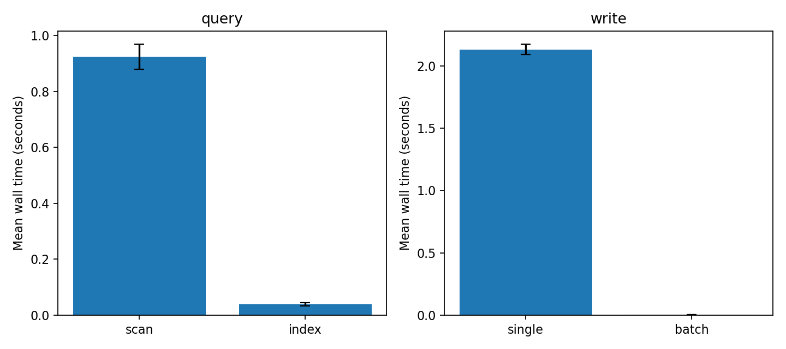
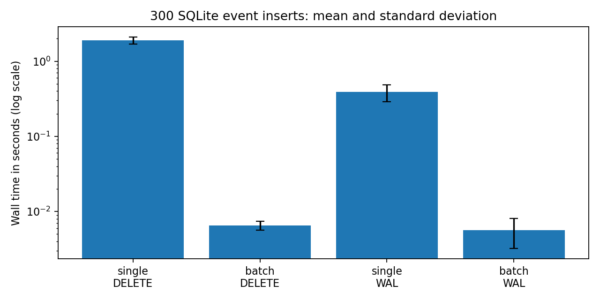
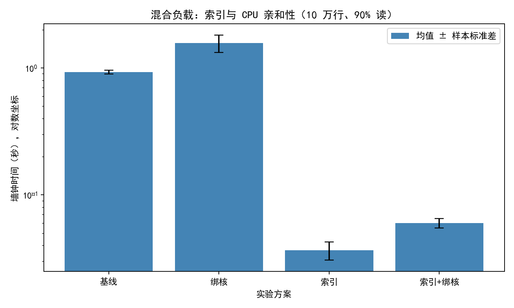
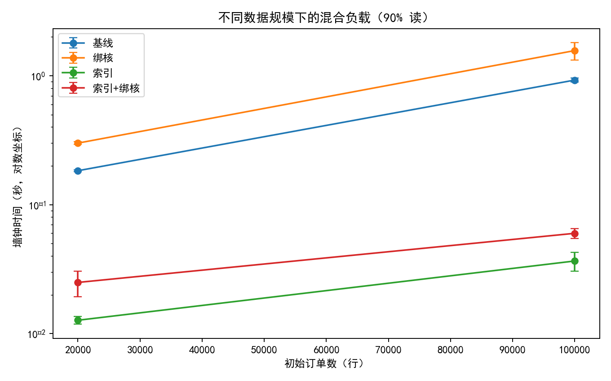
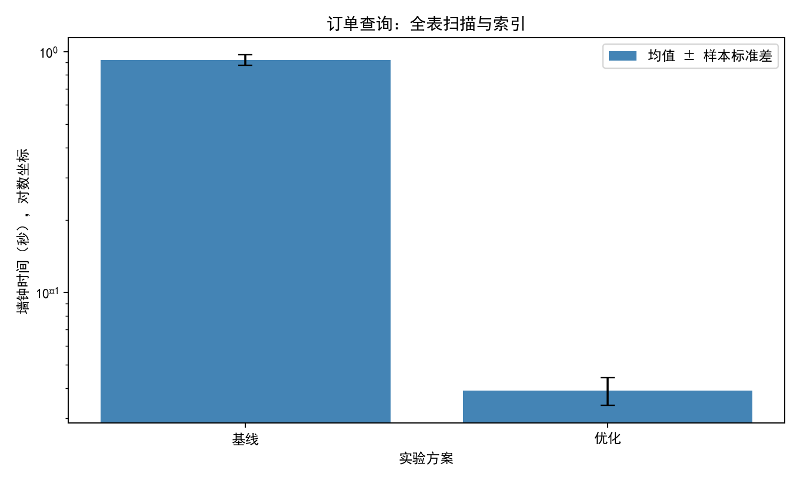
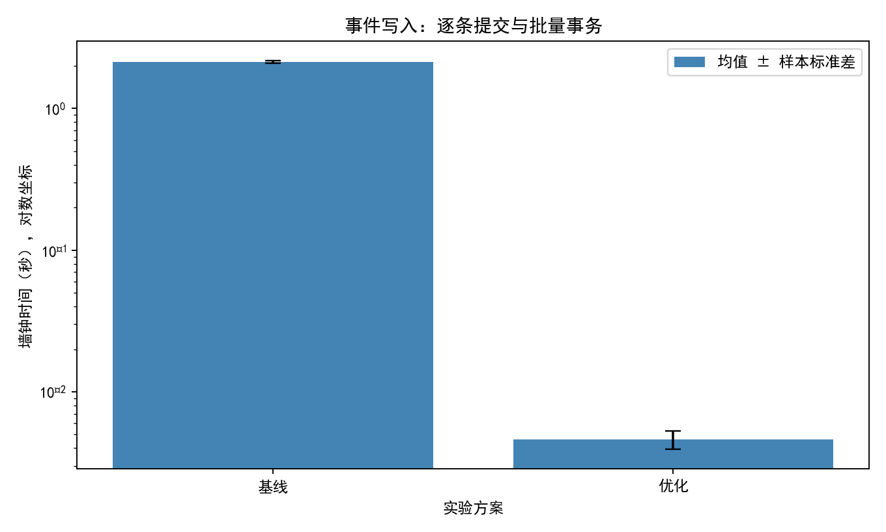
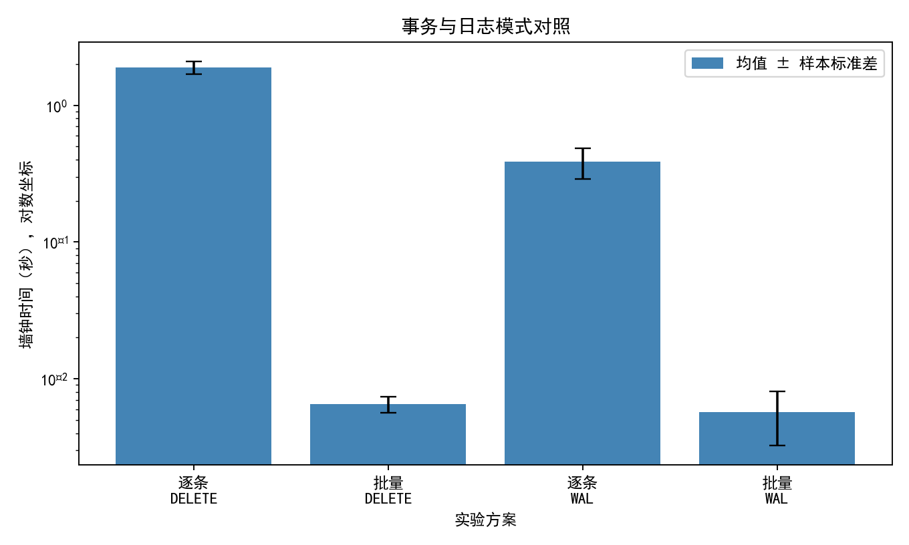

# 面向真实业务负载的 SQLite 数据库跨层性能优化与可复现实验研究

## 摘要与关键词
本研究以 SQLite 数据库和可重复生成的订单业务模拟，测量索引、事务批处理、数据库日志和 Windows CPU 亲和性。结果显示索引与批量事务改善所测工作负载，绑核在本机反而变慢。各组五次重复并验证查询及持久化数据。实验使用合成业务负载，不是生产轨迹。

关键词：SQLite、索引、事务、WAL、CPU 亲和性、可复现性。

## 研究背景和目标
订单系统的查询和事件写入需要兼顾响应时间与吞吐量。本项目研究数据库索引、事务批处理，以及可供 Linux 环境执行的 LLVM BOLT 二进制布局和 CPU 亲和性实验。SQLite 是真实开源数据库；本实验的订单和查询是合成的，不能称为真实线上业务负载。BOLT 的 hfsort+、ext-tsp 是已有实现，并非本项目提出。

## 环境与方法
实际运行环境为 Windows 11、Python 3.13.9、SQLite 3.51.0、Intel CPU；详细信息见原始数据。固定随机种子生成 10 万订单，查询 200 组客户和状态；写入 500 条事件。查询与写入分别测试两个方案，各重复 5 次。计时为墙钟时间；CPU 使用率为进程 CPU 时间除墙钟时间，可受系统计时精度影响。吞吐量按操作数除平均总耗时。速度比是同一工作负载基线平均时间除优化平均时间。每次查询结果摘要一致，写入校验行数为 500。

基线查询计划为全表扫描；联合索引使 SQLite 能按客户和状态定位。事务实验将逐条提交改为一次提交，减少提交次数；其原子性和故障恢复语义不同。两种优化作用于不同负载，不能将它们的加速比相乘，也没有测量组合方案。

## 实测结果

| 负载 | 方案 | 平均时间（秒） | 标准差（秒） | 吞吐量（次/秒） | CPU 使用率 | 加速比 |
|---|---|---:|---:|---:|---:|---:|
| 查询 200 次 | 扫描 | 0.9239 | 0.0445 | 216.5 | 79.8% | 1.00 |
| 查询 200 次 | 索引 | 0.0390 | 0.0052 | 5122.4 | 81.9% | 23.66 |
| 写入 500 条 | 逐条提交 | 2.1305 | 0.0409 | 234.7 | 52.6% | 1.00 |
| 写入 500 条 | 批量提交 | 0.00461 | 0.00069 | 108565.4 | 76.1% | 462.59 |

[原始逐次数据](data/sqlite-results.json) 包含环境、执行计划和校验值；误差线表示样本标准差。

索引改变了访问路径，解释了查询时间下降；批处理减少提交和持久化次数，是写入改善的合理解释，但本机没有系统调用或 I/O 剖析证据来量化各因素。没有采集硬件计数器。

## BOLT 与 Linux 系统层
本机未发现 LLVM BOLT、Clang 或 perf，WSL 返回访问被拒绝，因此 Linux BOLT、Linux CPU 亲和性及其组合未运行，也没有 perf 热点、IPC 或 cache miss 数据。`bolt-experiment` 提供实验脚本；这些方案尚未完成实际验证，不能将其视为已实测的 BOLT 结果；Windows 系统层实验见后文。BOLT 使用采样 profile 调整代码布局；是否存在布局瓶颈、绑核是否有效，必须由 Linux 实验数据验证。脚本使用相同负载采样和测试，存在训练偏差。

## 相关工作与局限
SQLite 官方查询规划文档描述索引对检索路径的影响，事务文档描述提交的原子性；LLVM BOLT 文档说明基于 profile 的二进制布局优化。本报告只比较本实验内基线和优化，没有对其他论文进行实测比较。固定测试顺序、单机单线程、合成数据、短批次和有限轮数限制外推；索引建立开销、并发、尾延迟、独立训练集均未覆盖。写入结果依赖存储与同步策略，批量事务改变故障时的提交边界。

## 参考文献
1. SQLite, [Query Planning](https://www.sqlite.org/queryplanner.html).
2. SQLite, [Transactions](https://www.sqlite.org/lang_transaction.html).
3. LLVM, [BOLT documentation](https://github.com/llvm/llvm-project/blob/main/bolt/README.md).

## 补充：应用事务与数据库存储日志的组合实验

为在当前 Windows 环境中完成可执行的跨层对照，新增 2×2 实验：应用层逐条提交或批量提交；SQLite 存储引擎层采用 DELETE 回滚日志或 WAL 日志。WAL 是数据库存储/I/O 层的配置，不是操作系统文件缓存优化或硬件优化。原有查询索引实验也保留在上文。数据库是 SQLite，订单事件数据为合成负载，并非来自真实线上业务。

每组在独立临时数据库写入相同 300 条记录，开启 `synchronous=FULL`，每组五次，各轮随机顺序；计时包含提交、WAL checkpoint 和关闭，随后重新打开并逐条核对数据。应用批处理减少事务提交次数；DELETE 与 WAL 分别使用回滚日志和预写日志，改变数据库访问文件的方式。逐条提交基线的多次持久化是可能的瓶颈，结合 WAL 单项结果支持这一判断，但没有 I/O 系统调用追踪，无法量化各机制的贡献。结果如下，误差为样本标准差。

| 事务 | 日志 | 平均秒数 ± 标准差 | 写入条/秒 | CPU 利用率 | 相对基线 |
|---|---|---:|---:|---:|---:|
| 逐条 | DELETE | 1.3080 ± 0.0153 | 229.4 | 50.4% | 1.00× |
| 批量 | DELETE | 0.00475 ± 0.00047 | 63173.6 | 65.8% | 275.45× |
| 逐条 | WAL | 0.2861 ± 0.00449 | 1048.5 | 28.3% | 4.57× |
| 批量 | WAL | 0.00465 ± 0.00091 | 64546.4 | 85.3% | 281.43× |

[逐次原始结果](data/factorial-results.json) 含运行顺序、CPU 时间、校验值与环境。组合相比批量 DELETE 的差异很小，且小于标准差，不能据此认定 WAL 在批量事务下有稳定收益。短任务的 Windows CPU 计时精度会影响 CPU 百分比。批量提交改变中途崩溃时的提交边界；WAL 改变日志和 checkpoint 行为，且 `FULL` 不能保证所有硬件都兑现同步请求。实验未覆盖并发或断电恢复，不应外推到生产。

复现：`python factorial_experiment.py`，然后 `python plot_factorial.py`（绘图需要 matplotlib）。重新运行将覆盖数据和图，需要同步更新报告数值。原有 BOLT 部分仍未实测。

参考：[SQLite WAL](https://www.sqlite.org/wal.html)、[SQLite synchronous pragma](https://www.sqlite.org/pragma.html#pragma_synchronous)。

### 课程要求核对
- 完整测量、分析、优化、验证：SQLite 查询和写入实验已完成；写入瓶颈原因是结合机制和对照的推断，缺少底层追踪。
- 两个不同层次：应用事务和数据库存储日志均已实测，但两者均属软件层；是否符合教师对软硬件层次的具体解释需教师确认，新增 Windows CPU 亲和性实测，见下文；没有硬件级参数优化。
- 单项与组合：2×2 写入对照各五次，已校验完整数据。
- 可复现与交付：代码、环境信息、原始数据、图表和报告已提供；本目录尚未初始化 Git 仓库。
- 与相关工作对比：给出官方资料与实验内基线，尚无与文献结果的定量对比。

## Windows CPU 亲和性与混合负载（已实测）

假设：单线程运行时迁移可能损害缓存局部性，固定 CPU 有可能降低迁移成本，但也可能带来竞争或限制调度。实验通过 psutil 将进程固定到原允许集合中编号最小的逻辑 CPU，基线保留原集合。没有采集迁移计数，因此不能断言变慢的具体原因。

订单初始 2 万或 10 万行，固定种子生成 300 次混合操作，读比例参数为 50% 或 90%，实际读写数保存在原始数据中。每个规模和比例采用无索引/索引与不绑核/绑核 2×2 对照，每组五次，共 80 次；顺序由固定种子打乱，每次独立子进程和临时数据库。建表及索引构建不计时；计时包括事务内 SQL、提交和关闭，不单独执行 checkpoint。重新打开数据库并读取全部行，连同查询结果计算摘要，同一负载下所有组摘要一致。吞吐量为读写合计操作数除墙钟时间，不是单独 QPS 或 TPS。

10 万行、90% 读的结果：

| 方案 | 均值 ± 标准差（秒） | 中位数（秒） | 操作/秒 | 相对基线 |
|---|---:|---:|---:|---:|
| 无索引、不绑核 | 0.9259 ± 0.0331 | 0.9117 | 324.0 | 1.00× |
| 无索引、绑核 | 1.5679 ± 0.2411 | 1.5482 | 191.3 | 0.59× |
| 索引、不绑核 | 0.03657 ± 0.00600 | 0.03499 | 8203.9 | 25.32× |
| 索引、绑核 | 0.05995 ± 0.00525 | 0.05899 | 5003.9 | 15.44× |

绑核使无索引方案时间增加约 69%，索引方案增加约 64%，未测得系统层收益；不能假设绑核一定有效。所有规模和比例的统计量与逐次数据见 [混合负载数据](data/mixed-affinity-results.json)。其中包含用户态/内核态 CPU 时间、起止 RSS、进程 I/O 计数、执行计划和校验摘要。短任务的 CPU 时间受系统计时分辨率影响；RSS 是快照而非峰值，I/O 计数不等于物理磁盘流量。缓存未清空，索引构建不计时；硬件 cache miss、IPC 和迁移计数未采集。

## 相关工作和最终课程核对

SQLite 查询规划器使用索引减少扫描；WAL 使用追加日志，批量事务可减少提交次数。Windows 亲和性是一种调度约束，不保证提升性能。实验比较项目内基线，不声称与文献结果有定量对比。参考 [SQLite 查询规划](https://www.sqlite.org/queryplanner.html)、[SQLite WAL](https://www.sqlite.org/wal.html)、[Windows 进程亲和性](https://learn.microsoft.com/en-us/windows/win32/api/winbase/nf-winbase-setprocessaffinitymask)。

已完成真实 SQLite 程序、模拟业务负载、基线与正确性验证、各组五次测量及应用/数据库/操作系统层的对照；亲和性是已测但未产生收益的优化尝试。真实线上轨迹、硬件计数器、公开文献定量对比和 BOLT 实测未完成。不同规模只覆盖两个点，样本数量有限；未来应增加生产负载、跨机器重复和底层性能追踪。

## 综合讨论与结论

**实测事实。** 10 万行、90% 读的混合负载中，固定一个逻辑处理器后，无索引组均值由 0.9259 秒升至 1.5679 秒；有索引组由 0.03657 秒升至 0.05995 秒。两组均各有五次独立运行；各组标准差分别为 0.0331、0.2411、0.00600 和 0.00525 秒。实验顺序经过随机化，但它不能消除短时负载、缓存状态或系统调度造成的所有偏差。

**可能原因而非测量结论。** 绑核限制调度器可选 CPU，若被选中的逻辑 CPU 负载较高、频率或核心类型较慢、或与其他线程争用资源，就可能抵消减少迁移的收益。测量没有记录各核心频率、核心类型、迁移次数、调度等待或 cache miss，不能确定哪一种原因导致本次下降。亲和性作用于实验进程，操作系统及其他进程仍可在同一 CPU 上运行。后续可在空闲机器逐核重复，并采集调度追踪与硬件计数器。

应用层和数据库访问路径优化在本次实验中有明显收益；数据库日志模式的收益依赖事务批次；系统调度约束反而降低了性能。本研究证明需要通过对照实验检验跨层措施，而非预先假定某个设置必然有效。应用场景是生成的代表性订单模型，其业务真实性和外推性有限。仅有单机五次样本，不能支持生产收益或统计显著性的普遍结论。BOLT 实验仍未执行，不能作为本报告的实测成果。

## 可复现性与结果来源

`data/sqlite-results.json`、`data/factorial-results.json` 与 `data/mixed-affinity-results.json` 为报告所引用的三批原始测量；本报告的均值、标准差及速度比取自对应 summary，`python scripts/verify_data.py` 可从每次记录核验均值和样本标准差。`python reproduce.py` 重新执行混合实验，输出至独立时间戳目录，不覆盖原始数据；两项历史实验的脚本默认覆盖各自历史 JSON，重跑前须备份。不同测试的计时范围和持久化语义不能直接混合比较。
